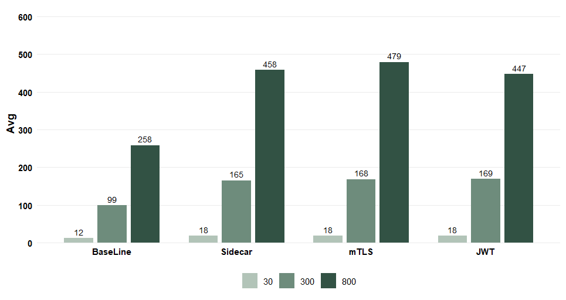
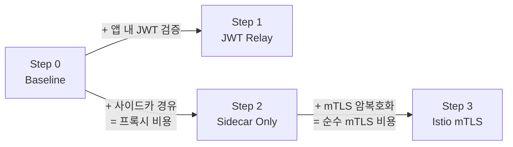
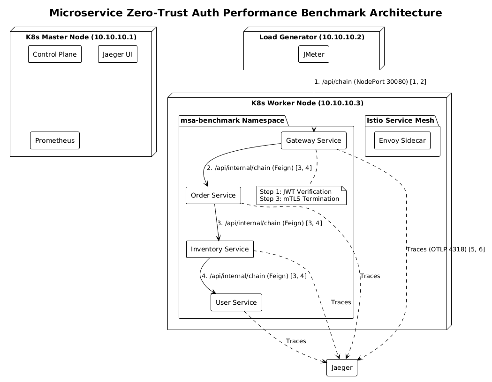

# MSA Auth Performance Benchmark

**마이크로서비스(MSA) 환경의 제로 트러스트 서비스 간 통신 인증 방식 성능 분석** — 학사 학위 논문 프로젝트

서비스끼리 주고받는 내부 호출을 **애플리케이션이 직접 인증할 때(JWT Token Relay)** 와 **인프라가 대신 인증할 때(Istio mTLS)**, 처리량·지연 시간·CPU가 어떻게 달라지는지 Kubernetes 위 4단계 호출 체인에서 측정했습니다.

[](https://openjdk.org/)
[](https://spring.io/projects/spring-boot)
[](https://kubernetes.io/)
[](https://istio.io/)
[](LICENSE)

| 항목 | 내용 |
|---|---|
| 기간 | 2026.03 ~ 진행 중 |
| 인원 | 2명 |
| 형태 | 학사 학위 논문 (유한대학교 컴퓨터공학과) |
| 문서 | [논문 계획서](https://docs.google.com/document/d/1RiJlxUNSNpEuJ8rgcCDKBGPZNdBSaH8e/edit?usp=sharing&ouid=104391096948093738115&rtpof=true&sd=true) · [논문 본문](https://docs.google.com/document/d/1y2XVFpZfJl1_UD54xl5DnxSDcFfAZuR2/edit?usp=sharing&ouid=104391096948093738115&rtpof=true&sd=true) · [개발 단계별 문서](docs/README.md) |

## 왜 이 연구를 했나

제로 트러스트는 "내부의 어떤 주체도 믿지 않고 항상 검증한다"는 원칙이라, 서비스 사이 내부 호출(East-West)에도 암호화와 상호 인증을 요구합니다. 구현 방법은 크게 두 가지입니다.

- **JWT Token Relay** — 각 서비스가 토큰 서명을 직접 검증하고 다음 서비스로 같은 토큰을 넘깁니다.
- **Istio mTLS** — 서비스 옆의 Envoy 사이드카가 인증서 교환과 암호화를 대신합니다. 애플리케이션 코드는 그대로입니다.

그런데 기존 연구는 대부분 **단일 홉**만 측정했고, 서비스 메시 비용에서 **사이드카를 거치는 비용**과 **mTLS 암복호화 비용**을 나누지 않았습니다. 그래서 세 가지를 물었습니다.

1. 3-Depth 연쇄 호출에서 두 방식의 처리량·지연은 얼마나 다른가?
2. 서비스 메시 비용 중 프록시 비용과 순수 mTLS 비용은 각각 얼마인가?
3. 인증 연산은 어느 컨테이너의 CPU를 쓰는가?

자세한 내용: [문제 정의](docs/PROBLEM_DEFINITION.md)

## 결과 한눈에 보기

고부하(동시 800) 기준입니다. 전체 수치와 해석은 [docs/RESULTS.md](docs/RESULTS.md)에 있습니다.

| 지표 | Baseline | JWT Relay | Sidecar Only | Istio mTLS |
|---|---:|---:|---:|---:|
| TPS | 3,077.6 | 1,741.7 | 1,732.3 | 1,652.1 |
| 평균 지연 (ms) | 258 | 447 | 458 | 479 |

<p align="center"></p>

- **두 방식의 차이는 크지 않았습니다.** 고부하에서 mTLS가 JWT보다 32ms 느리고 TPS는 약 5% 낮았습니다. 저부하에서는 둘 다 18ms로 같았습니다.
- **서비스 메시 비용의 대부분은 암호화가 아니라 프록시였습니다.** Baseline 대비 mTLS 지연 증가 221ms 중 사이드카 경유가 200ms, 순수 mTLS가 21ms였습니다. TLS 연결이 커넥션 풀로 재사용되기 때문으로 해석했습니다.
- **mTLS는 CPU를 줄이는 게 아니라 옮깁니다.** Gateway 앱 CPU는 JWT 1,986m → mTLS 522m로 줄었지만, 사이드카가 786m를 썼습니다. 체인 중간의 Order·Inventory는 앱 + 사이드카 합계가 오히려 JWT보다 많았습니다. 이점은 총량 절감이 아니라 **보안 연산을 비즈니스 로직과 격리**한다는 데 있습니다.

결론적으로, 지연 차이가 작고 보안 연산을 인프라로 격리해 여러 언어의 서비스에 같은 정책을 일괄 적용할 수 있다는 점에서 **대규모 MSA의 서비스 간 인증에는 Istio mTLS가 더 적합하다**고 판단했습니다.

## 실험 설계

애플리케이션 코드는 하나로 두고, **환경변수 `APP_MODE`와 Istio 설정만 바꿔** 네 가지 조건을 만들었습니다.



| 항목 | 내용 |
|---|---|
| 호출 체인 | API Gateway → Order → Inventory → User (내부 3구간) |
| 부하 | 동시 스레드 30 / 300 / 800 (Step 0 CPU 80~85% / 85~90% / 90%+ 기준) |
| 측정 절차 | Startup Wait 1~3분 → Warm-up 10~60초 → 본 측정 60초, 조건마다 3회 반복 후 평균에 가장 가까운 회차 사용 |
| 지표 | TPS, 평균 지연(p99 보조), 컨테이너별 CPU·메모리, Jaeger 구간 지연 |
| 환경 | VMware VM 3대(각 6 Core / 12GB, Ubuntu 22.04)를 부하 발생 / 컨트롤 플레인·관측 / 워커로 분리 |

자세한 내용: [실험 설계](docs/EXPERIMENT_DESIGN.md)

## 아키텍처

<p align="center"></p>

| 구성 요소 | 역할 |
|---|---|
| `gateway-service` (8080, NodePort 30080) | 부하가 들어오는 진입점 |
| `order` / `inventory` / `user-service` (8081~8083) | OpenFeign으로 이어지는 내부 호출 체인 |
| `benchmark-common` | `APP_MODE`에 따라 켜지는 JWT 검증 보안 설정 |
| `benchmark-feign-common` | 받은 `Authorization` 헤더를 다음 호출에 붙이는 Feign 인터셉터 |
| `benchmark-tools` | 실험용 HS256 JWT 생성 CLI |
| Jaeger / Prometheus | 분산 추적 / 컨테이너 메트릭 |

설계하면서 고민한 부분입니다. 전체 결정 기록은 [docs/ADR.md](docs/ADR.md)에 있습니다.

- **조건 사이에 코드가 달라지면 안 됩니다.** `APP_MODE`를 Spring 프로파일로 쓰고, JWT 관련 빈은 `@ConditionalOnProperty`로 `jwt-relay`에서만 켰습니다. Step 0·2·3은 같은 이미지를 쓰고 Istio 설정만 다릅니다.
- **측정 도구가 측정 대상을 오염시키면 안 됩니다.** JMeter, 컨트롤 플레인·Jaeger·Prometheus, 서비스를 서로 다른 VM에 두고, 서비스는 node affinity로 워커 노드에 고정했습니다.
- **비용을 한 번에 하나씩 더했습니다.** Sidecar Only 단계를 따로 둬서 "프록시를 거치는 비용"과 "암호화 비용"을 나눴습니다.

자세한 내용: [아키텍처](docs/ARCHITECTURE.md) · [API](docs/API_SPEC.md)

## 트러블슈팅

### Jaeger 메모리 증가로 노드가 멈추던 문제

- **문제:** 고부하 측정 중 Jaeger가 트레이스를 메모리에 계속 쌓으면서 메모리 사용량이 늘었고, 결국 노드가 멈췄습니다. 기본 설정(`TRACING_SAMPLE_PROBABILITY=1.0`)에서는 모든 요청이 4개 서비스에서 각각 스팬을 만듭니다.
- **해결:** 트레이싱 설정(샘플링 비율 `TRACING_SAMPLE_PROBABILITY` 등)을 조정해 측정 환경을 안정화했습니다.
- **배운 점:** 인증 방식뿐 아니라 **관측 도구의 설정도 측정 결과에 영향을 줍니다.** 성능 실험에서는 측정 도구의 부하도 통제 변수로 다뤄야 합니다.

대응 절차는 [docs/RUNBOOK.md](docs/RUNBOOK.md)에 정리했습니다.

## 한계와 다음 과제

- 서비스에 비즈니스 로직이 없어 인증 비용의 비중이 실제 서비스보다 크게 나옵니다. 절대값보다 조건 간 차이로 봐야 합니다.
- 서비스 4개가 워커 노드 하나의 CPU를 나눠 쓰고, 조건마다 3회만 측정했습니다.
- JWT는 HS256만 측정했습니다. RS256 같은 비대칭 서명은 검증 비용이 다릅니다.
- 실험 당시 Istio 정책 파일을 저장소에 보관하지 않아, 재현용 예시로 대신했습니다. 보관이 가장 먼저 할 일입니다.
- `jwt-relay` 모드에서는 헬스 체크(`/actuator/health`)도 인증을 요구해 Kubernetes 프로브가 실패합니다. 수정 방법을 [docs/VERIFICATION.md](docs/VERIFICATION.md#3-알려진-문제)에 적었습니다.

전체 목록은 [docs/STATUS.md](docs/STATUS.md#4-남은-과제)에 있습니다.

## 팀

| 팀원 | 역할 | 담당 |
|---|---|---|
| 김형균 | PM | 프로젝트 설계, 워커 노드 프로그램 구현, Kubernetes 실험 환경 구성, JWT Relay·Istio mTLS 비교 환경 구축, 성능 측정·분석, 논문 작성 |
| 최가은 | 팀원 | 구현 세부 오류 수정, 노드 배포 설정, 부하 테스트 및 성능 측정 |

## 기술 스택

| 분류 | 기술 |
|---|---|
| Language | Java 17 |
| Framework | Spring Boot 3.2.5, Spring Cloud 2023.0.1 (OpenFeign) |
| Security | Spring Security OAuth2 Resource Server (JWT HS256), JJWT |
| Service Mesh | Istio (Envoy 사이드카, mTLS STRICT) |
| Infra | Kubernetes v1.28.15, Docker, Docker Compose, VMware Workstation Pro |
| Observability | Micrometer Tracing, OpenTelemetry OTLP, Jaeger, Prometheus |
| Load Test | Apache JMeter |
| Build | Maven (멀티 모듈) |

## 빠른 시작

필요한 것: JDK 17, Maven 3.9+, Docker (Compose 포함)

```bash
git clone https://github.com/semicolon213/MSA-Auth-Performance-Benchmark.git
cd MSA-Auth-Performance-Benchmark
cp .env.example .env
docker compose up --build          # Gateway :8080, Jaeger UI :16686
curl http://localhost:8080/api/chain
```

JWT 모드:

```bash
export APP_MODE=jwt-relay && docker compose up --build
# 다른 터미널에서
mvn -pl benchmark-tools -am -DskipTests package
TOKEN=$(java -jar benchmark-tools/target/benchmark-tools-1.0.0-SNAPSHOT-exec.jar)
curl -H "Authorization: Bearer $TOKEN" http://localhost:8080/api/chain
```

- 설치부터 단계별 안내 (Ubuntu): [docs/실험-사용법-가이드.md](docs/실험-사용법-가이드.md)
- Kubernetes·Istio 조건별 배포: [docs/DEPLOYMENT.md](docs/DEPLOYMENT.md)
- 부하 테스트: [jmeter/README.md](jmeter/README.md)

저장소의 `JWT_SECRET` 기본값은 실험용 공개 값입니다. 다른 용도로 쓰지 마세요.

## 프로젝트 구조

```
├── benchmark-common/        # AppProperties, JwtRelaySecurityConfig
├── benchmark-feign-common/  # Feign Authorization 릴레이 인터셉터
├── gateway-service/         # 진입점 (8080)
├── order-service/           # 8081
├── inventory-service/       # 8082
├── user-service/            # 8083 (체인 끝)
├── benchmark-tools/         # HS256 JWT 생성 CLI
├── jmeter/                  # no-auth / jwt 테스트 플랜
├── k8s/                     # 네임스페이스, ConfigMap, 서비스 매니페스트
├── docs/                    # 개발 단계별 문서, 논문 그림
├── Dockerfile               # --build-arg SVC=<모듈>
└── docker-compose.yml       # 로컬 통합 실행 + Jaeger
```

## 문서

| 문서 | 내용 |
|---|---|
| [문서 안내](docs/README.md) | 개발 단계별 산출물 지도 |
| [문제 정의](docs/PROBLEM_DEFINITION.md) · [요구사항](docs/REQUIREMENTS.md) · [용어](docs/GLOSSARY.md) | 왜, 무엇을 |
| [실험 설계](docs/EXPERIMENT_DESIGN.md) · [아키텍처](docs/ARCHITECTURE.md) · [설계 결정(ADR)](docs/ADR.md) · [API](docs/API_SPEC.md) | 어떻게 |
| [배포](docs/DEPLOYMENT.md) · [실험 사용법 가이드](docs/실험-사용법-가이드.md) · [코드 규칙](docs/CONVENTIONS.md) | 실행·개발 |
| [실험 결과](docs/RESULTS.md) · [코드 검증](docs/VERIFICATION.md) | 결과와 품질 |
| [런북](docs/RUNBOOK.md) · [진행 현황](docs/STATUS.md) | 운영과 현황 |

## 라이선스

[MIT](LICENSE)
