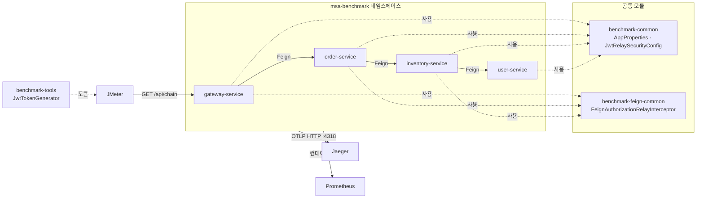
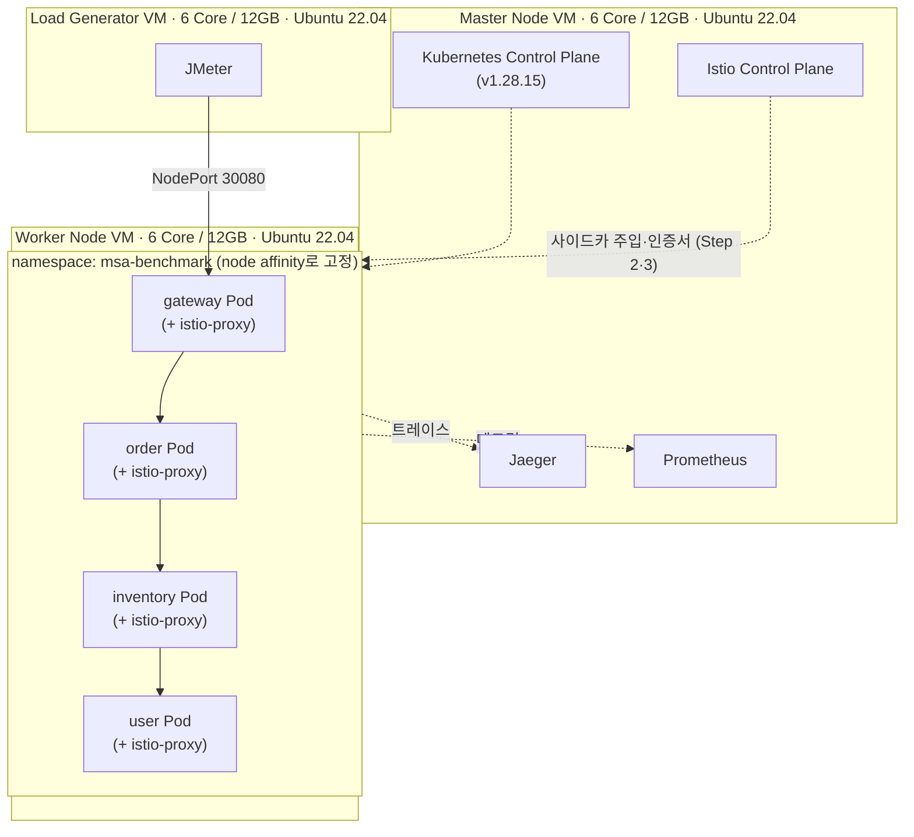
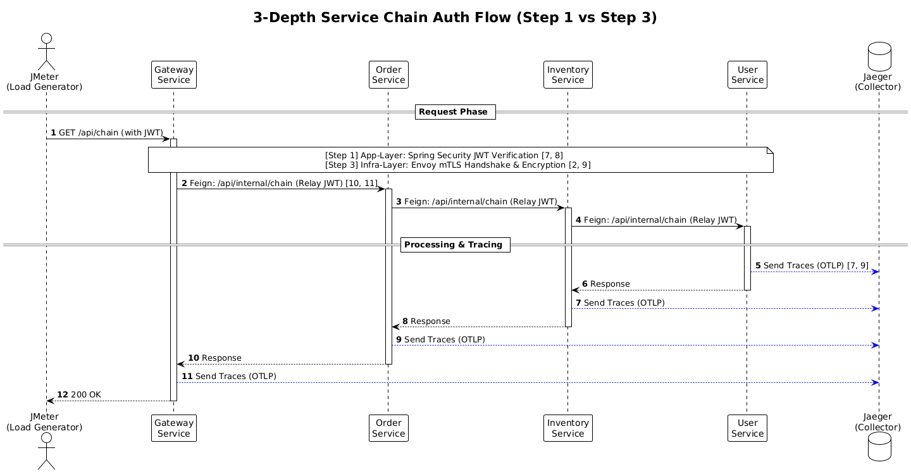
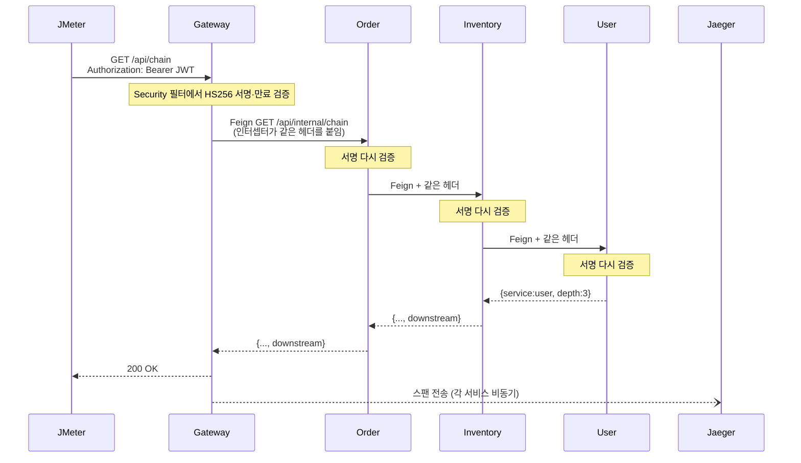
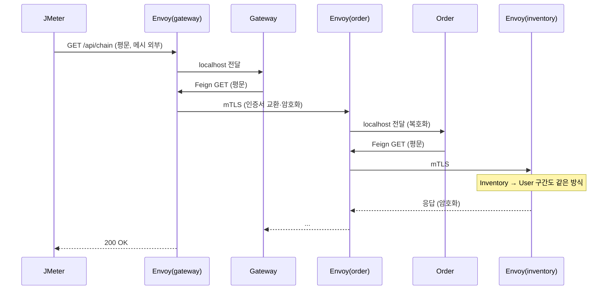
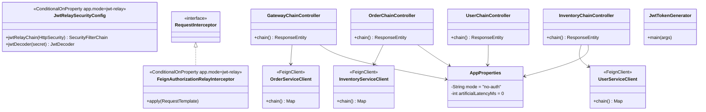
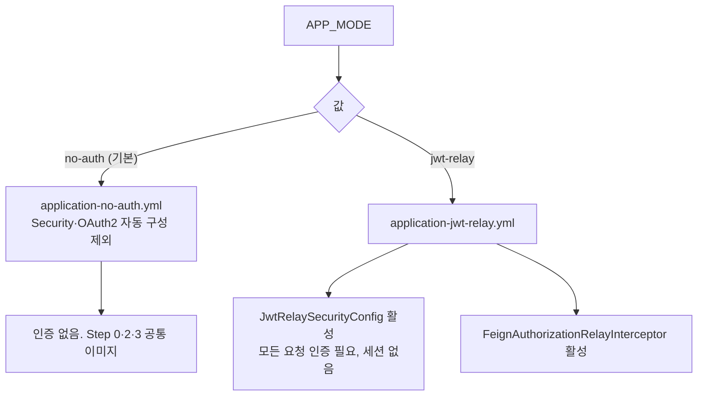
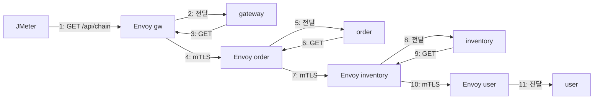
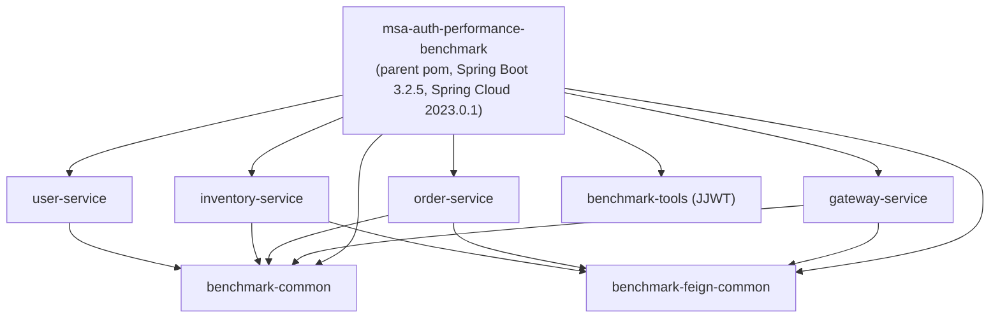

# 아키텍처

> 개발 단계: **③ 설계 / ④ 구조 생성** · 산출물: Component, Deployment, Sequence, Class, Communication, Package 다이어그램
> 결정 이유는 [ADR.md](./ADR.md)에 있습니다.

## 1. 개요

Spring Boot 서비스 4개가 HTTP로 한 줄로 이어진 호출 체인입니다. 체인 자체에는 비즈니스 로직이 없고, **인증을 어디서 처리하느냐**만 조건에 따라 달라집니다.

| 구성 요소 | 역할 |
|---|---|
| gateway-service | 외부 요청을 받는 진입점. 부하가 들어오는 곳 |
| order / inventory / user-service | 내부 연쇄 호출 대상. 깊이 1 / 2 / 3 |
| benchmark-common | `AppProperties`, JWT 검증 보안 설정 (모든 서비스 공통) |
| benchmark-feign-common | `Authorization` 헤더를 다음 호출에 붙이는 Feign 인터셉터 |
| benchmark-tools | 실험용 HS256 JWT 생성 CLI |
| Istio (Envoy 사이드카) | Step 2·3에서 각 Pod 트래픽을 가로챔. Step 3에서 mTLS 처리 |
| Jaeger | OTLP 트레이스 수집·조회 |
| Prometheus 등 | 컨테이너 CPU·메모리 수집 |
| JMeter | 부하 발생 |

## 2. Component 다이어그램

user-service는 다음 호출이 없어 `benchmark-feign-common`에 의존하지 않습니다.

## 3. Deployment 다이어그램

| 항목 | 값 | 출처 |
|---|---|---|
| 네임스페이스 | `msa-benchmark` | `k8s/namespace.yaml` |
| 레플리카 | 서비스별 1 | `k8s/*-service.yaml` |
| 노드 고정 | `kubernetes.io/hostname: node3` (환경에 맞게 교체) | 같은 파일 `nodeAffinity` |
| 외부 노출 | gateway만 `NodePort 30080`, 나머지는 ClusterIP | 같은 파일 |
| 공통 설정 | ConfigMap `msa-benchmark-env` (`APP_MODE`, `JWT_SECRET`, `OTLP_TRACES_ENDPOINT` 등) | `k8s/configmap-env.yaml` |
| 상태 확인 | `/actuator/health` liveness(50초 후 10초 간격)·readiness(25초 후 5초 간격) | 같은 파일 |
| 리소스 requests/limits | 지정 안 함 | 같은 파일 |
| Istio·Jaeger·Prometheus 설치 | 저장소에 없음 | [STATUS.md](./STATUS.md#4-남은-과제) |

## 4. Sequence 다이어그램

### 4.1 Step 1 JWT Token Relay

같은 토큰을 **4번** 검증합니다. 호출 깊이가 깊어질수록 검증 비용이 서비스마다 반복됩니다.

### 4.2 Step 3 Istio mTLS STRICT

애플리케이션은 `no-auth` 그대로이고, 암복호화와 상호 인증은 각 Pod의 `istio-proxy` 컨테이너가 합니다. TLS 연결은 커넥션 풀로 재사용되어 요청마다 핸드셰이크를 하지 않습니다.

## 5. Class 다이어그램

## 6. 설정과 프로파일

`APP_MODE`가 `spring.profiles.active`와 `app.mode`에 함께 들어갑니다.

| 환경변수 | 기본값 | 용도 |
|---|---|---|
| `APP_MODE` | `no-auth` | 인증 모드 |
| `SERVER_PORT` | 서비스별 8080~8083 | 포트 |
| `JWT_SECRET` | 실험용 공개 값 (32바이트 이상) | HS256 검증 키. 모든 서비스가 같아야 함 |
| `ARTIFICIAL_LATENCY_MS` | `0` | 컨트롤러마다 `Thread.sleep` |
| `ORDER/INVENTORY/USER_SERVICE_URL` | `http://localhost:808x` | 다음 서비스 주소 |
| `OTLP_TRACES_ENDPOINT` | `http://localhost:4318/v1/traces` | 트레이스 전송 주소 |
| `TRACING_SAMPLE_PROBABILITY` | `1.0` | 트레이스 샘플링 비율 |

## 7. Communication 다이어그램 (Step 3, 요청 1건)

요청 하나가 애플리케이션 4개와 사이드카 4개를 지나며, 서비스 사이 3구간이 mTLS입니다.

## 8. Package 다이어그램 (Maven 모듈)

| 모듈 | 주요 의존성 |
|---|---|
| benchmark-common | spring-boot-starter-security, oauth2-resource-server |
| benchmark-feign-common | spring-cloud-starter-openfeign |
| *-service | starter-web, openfeign(user 제외), actuator, micrometer-tracing-bridge-otel, opentelemetry-exporter-otlp, micrometer-registry-prometheus |
| benchmark-tools | jjwt |

## 9. 관측

- **트레이스:** Micrometer Tracing(OpenTelemetry 브리지)이 HTTP 서버·Feign 클라이언트 구간마다 스팬을 만들고 OTLP HTTP로 Jaeger에 보냅니다. 로그 레벨 앞에 `[서비스명,traceId,spanId]`가 붙습니다.
- **메트릭:** `/actuator/prometheus`로 JVM·HTTP 메트릭을 노출합니다. 논문의 컨테이너 CPU는 Kubernetes 컨테이너 메트릭 기준입니다.
- 샘플링 기본값이 1.0(모든 요청 추적)이라, 고부하에서는 트레이싱 자체가 CPU·메모리를 씁니다.
