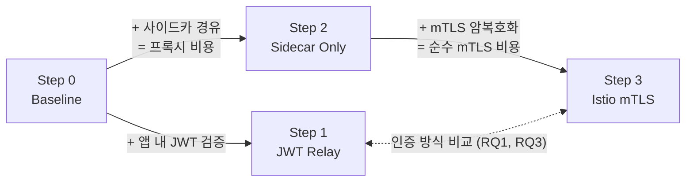
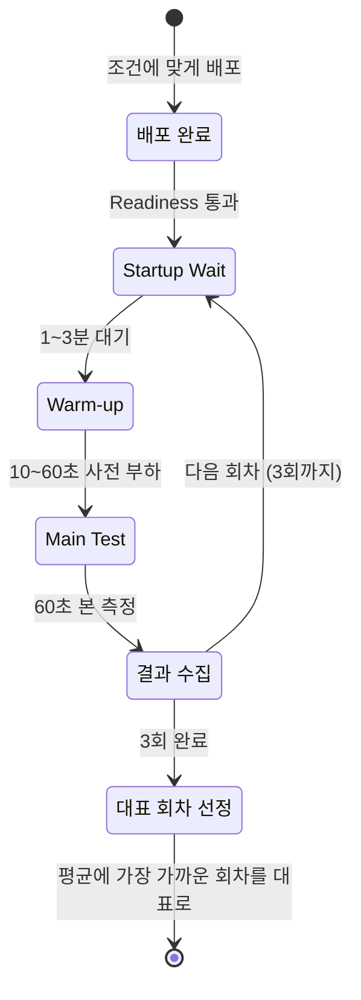

# 실험 설계

> 개발 단계: **③ 설계** · 산출물: 실험 조건, 부하 케이스, 평가 지표, 측정 절차
> 근거: 논문 본문 3장 2절. 계획서와 달라진 점은 [§6](#6-계획서와-달라진-점)에 있습니다.

## 1. 통제 원칙

- **애플리케이션 코드는 하나.** 조건은 `APP_MODE` 환경변수와 Istio 설정으로만 바꿉니다.
- **바뀌는 변수는 한 번에 하나.** Step을 하나씩 더하며 비용을 단계별로 분리합니다.
- **측정 대상과 측정 도구를 다른 노드에.** 부하 발생기, 컨트롤 플레인·관측 도구, 서비스를 서로 다른 VM에 둡니다.

## 2. 실험 조건

| 단계 | 이름 | 보안 처리 위치 | `APP_MODE` | 사이드카 | mTLS |
|---|---|---|---|---|---|
| Step 0 | Baseline | 없음 | `no-auth` | 없음 | 없음 |
| Step 1 | JWT Relay | 애플리케이션 계층 | `jwt-relay` | 없음 | 없음 |
| Step 2 | Sidecar Only | 인프라 계층 (프록시) | `no-auth` | 주입 | 끔 |
| Step 3 | Istio mTLS | 인프라 계층 (인증) | `no-auth` | 주입 | STRICT |

조건을 비교해 얻는 값:

| 비교 | 의미 | 연구 질문 |
|---|---|---|
| Step 1 − Step 0 | 애플리케이션 계층 JWT 검증·릴레이 비용 | RQ1 |
| Step 2 − Step 0 | 사이드카를 거치는 비용 | RQ2 |
| Step 3 − Step 2 | mTLS 암복호화·상호 인증 비용 | RQ2 |
| Step 1 vs Step 3 | 두 인증 방식의 처리량·지연·CPU | RQ1, RQ3 |

## 3. 부하 케이스

부하 강도는 Step 0에서 워커 노드 CPU 사용률이 각각 80~85%, 85~90%, 90% 이상이 되도록 정했습니다.

| 구분 | 케이스 | 동시 스레드 | Ramp-up | 측정 시간 |
|---|---|---|---|---|
| 저부하 | TC 1 | 30 | 3초 | 60초 |
| 중부하 | TC 2 | 300 | 30초 | 60초 |
| 고부하 | TC 3 | 800 | 80초 | 60초 |

- 요청: `GET http://<워커 노드>:30080/api/chain` (JWT 조건은 `Authorization: Bearer <토큰>`)
- 스레드는 응답을 받으면 바로 다음 요청을 보냅니다(think time 없음). 그래서 스레드 수는 "동시에 처리 중인 요청 수"에 가깝습니다.
- 조건 4개 × 부하 3개 × 3회 = **36회** 측정

## 4. 평가 지표

| 범주 | 지표 | 수집 | 용도 |
|---|---|---|---|
| 처리량 | TPS | JMeter | 부하별 처리 한계 |
| 지연 시간 | 평균 응답 시간 (주 지표), p99 (보조) | JMeter | 사용자 체감 지연, 꼬리 지연 |
| 자원 | 컨테이너별 평균 CPU·메모리 | 메트릭 수집기 | 인증 연산이 어디서 CPU를 쓰는지 |
| 구간 지연 | 서비스·호출 구간별 스팬 시간 | Jaeger | 라우팅 시간과 인증·암복호화 시간 분리 |

## 5. 측정 절차

| 단계 | 하는 일 | 이유 |
|---|---|---|
| Startup Wait | 배포 직후 1~3분 아무것도 하지 않음 | 프레임워크 초기화, 커넥션 풀 생성, 컨트롤 플레인 CPU 급증이 측정에 섞이지 않게 |
| Warm-up | 10~60초 동안 부하를 서서히 올림 | JVM 클래스 로딩·JIT 컴파일로 생기는 초기 지연(콜드 스타트) 제거 |
| Main Test | 목표 부하를 60초 유지 | 이 구간의 데이터만 사용 |
| 대표 회차 선정 | 3회 평균에 가장 가까운 회차 선택 | 이상치 한 번에 결과가 흔들리지 않게 |

실행 명령은 [docs/실험-사용법-가이드.md](./실험-사용법-가이드.md)와 [DEPLOYMENT.md](./DEPLOYMENT.md)에 있습니다.

## 6. 계획서와 달라진 점

| 항목 | 계획서 | 실제 실험 | 비고 |
|---|---|---|---|
| 동시 사용자 | 저 10~50, 중 100~300, 과 500~1,000+ | 30 / 300 / 800 | Step 0 CPU 사용률 기준으로 구간을 고정 |
| 측정 시간 | 조건별 5분 | 60초 (Ramp-up 이후) | 최대 부하 도달 뒤 구간만 비교 |
| 웜업 | 1분 | 10~60초 + 사전 대기 1~3분 | 대기와 웜업을 나눠 각각의 목적을 분리 |
| 요청 패턴 | 균등·집중·순차 3가지 | 순차 호출(`/api/chain`) 1가지 | 논문 결과는 순차 호출 패턴만 사용 |
| Step 2 mTLS 설정 | Istio PERMISSIVE | mTLS 비활성화 | PERMISSIVE에서는 사이드카끼리 자동으로 mTLS를 쓸 수 있으므로, 순수 프록시 비용을 재려면 mTLS를 확실히 꺼야 합니다. 당시 Istio 설정 파일은 저장소에 없어 보관이 필요합니다([STATUS.md](./STATUS.md#4-남은-과제)) |
