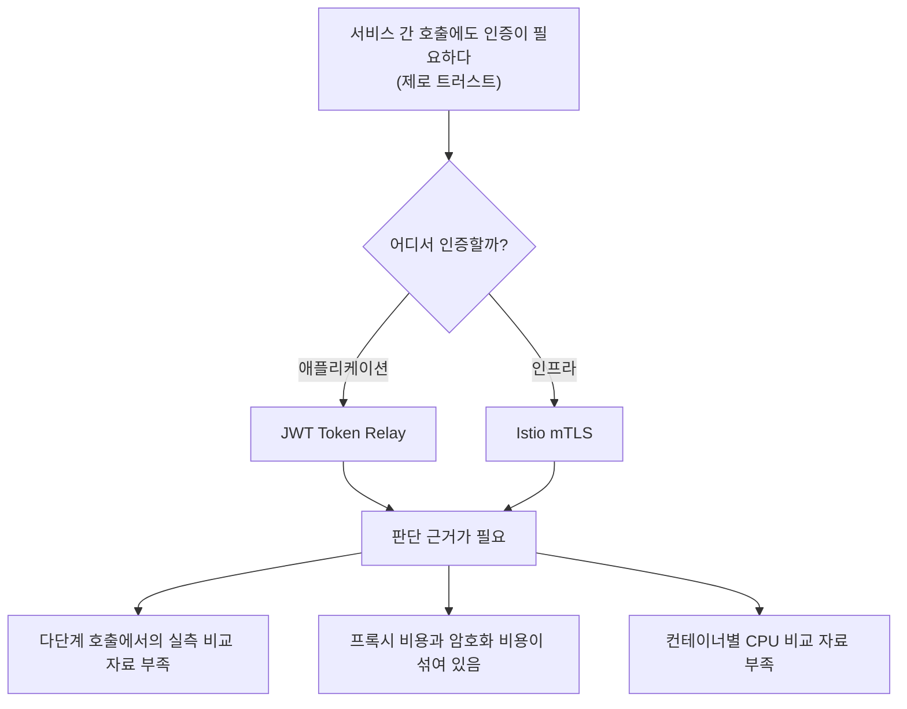

# 문제 정의

> 개발 단계: **① 문제 정의** · 산출물: 연구 배경, 연구 질문, 목표, 범위, 제약
> 근거: 논문 계획서, 논문 본문 1~2장

## 1. 배경

MSA는 하나의 애플리케이션을 도메인 단위 서비스로 나눕니다. 그 결과 외부→내부(North-South) 요청뿐 아니라 **서비스 사이의 내부 호출(East-West)** 이 크게 늘어납니다.

예전에는 방화벽 안쪽 트래픽을 믿는 경계 기반 보안이 주류였지만, 클라우드 환경에서는 그 경계가 흐려졌습니다. 그래서 "내부의 어떤 주체도 믿지 않고 항상 검증한다"는 **제로 트러스트(ZTA)** 가 표준이 되었고, 내부 서비스 간 호출에도 **암호화와 상호 인증**이 필요해졌습니다.

이를 구현하는 대표 방식은 두 가지입니다.

| 방식 | 처리 위치 | 동작 |
|---|---|---|
| JWT Token Relay | 애플리케이션 계층 | 각 서비스가 토큰 서명을 직접 검증하고, 다음 서비스로 같은 토큰을 넘김 |
| Istio mTLS | 인프라 계층 | 서비스 옆의 Envoy 사이드카가 인증서를 교환하고 트래픽을 암호화. 애플리케이션 코드는 그대로 |

두 방식은 CPU를 쓰는 위치와 지연 시간이 생기는 지점이 다릅니다. 그런데 어느 쪽을 고를지 판단할 정량 근거가 부족했습니다.

## 2. 문제

기존 연구에는 다음 공백이 있었습니다.

1. **단일 홉 위주:** 대부분 서비스 하나를 거치는 호출만 측정했습니다. 실제 MSA는 요청 하나가 여러 서비스를 연달아 거치므로, 비용이 호출 깊이에 따라 어떻게 쌓이는지는 알 수 없었습니다.
2. **비용이 섞여 있음:** 서비스 메시의 지연을 측정할 때 **사이드카를 한 번 더 거치는 비용**과 **mTLS 암복호화 비용**을 나누지 않았습니다.
3. **자원 소모 위치 미확인:** 인증 연산이 어느 컨테이너의 CPU를 쓰는지 서비스별로 비교한 자료가 드뭅니다.

## 3. 연구 질문

| ID | 질문 | 확인 방법 |
|---|---|---|
| RQ1 | 3-Depth 연쇄 호출에서 JWT Relay와 mTLS의 처리량·지연 시간은 얼마나 다른가? | Step 1 vs Step 3, 부하 3단계 |
| RQ2 | 서비스 메시 비용을 사이드카 경유 비용과 순수 mTLS 비용으로 나누면 각각 얼마인가? | Step 0 vs Step 2 (프록시 비용), Step 2 vs Step 3 (mTLS 비용) |
| RQ3 | 인증 연산은 어느 컨테이너의 CPU를 쓰는가? 호출 깊이에 따라 어떻게 달라지는가? | 고부하에서 서비스별 앱·사이드카 컨테이너 CPU |

실험 조건(Step 0~3)은 [EXPERIMENT_DESIGN.md](./EXPERIMENT_DESIGN.md)에 있습니다.

## 4. 목표

- 같은 애플리케이션 코드에서 **인증 방식만 바꿔** 비교할 수 있는 실험 환경을 만든다.
- 처리량(TPS), 평균 지연 시간, 컨테이너별 CPU를 측정해 인증 방식 선택의 근거를 낸다.
- 결과를 학사 학위 논문으로 정리한다.

이 프로젝트는 서비스가 아니라 실험이라 KPI 대신 **측정 지표**를 씁니다([EXPERIMENT_DESIGN.md §4](./EXPERIMENT_DESIGN.md#4-평가-지표)).

## 5. 범위

### 포함

- Spring Boot REST 서비스 4개로 만든 3-Depth 호출 체인 (Gateway → Order → Inventory → User)
- Kubernetes 단일 워커 노드 위 실험
- JWT Relay(HS256), Istio 사이드카(mTLS 꺼짐), Istio mTLS STRICT
- JMeter 부하, Jaeger 분산 추적, 컨테이너 메트릭 수집

### 제외

- 다른 프레임워크(Node.js, Go 등)와 다른 서비스 메시(Linkerd, Cilium 등)
- 사이드카 없는 메시(Istio Ambient)
- 토큰 발급 서버, 키 회전, 인가(권한) 정책
- 비동기 메시지(Kafka 등) 통신
- 실제 비즈니스 로직과 DB 접근 (서비스는 다음 서비스를 부르고 응답만 돌려줌)

## 6. 제약

| 제약 | 영향 |
|---|---|
| VMware Workstation Pro 가상머신 3대, 외부망과 분리된 네트워크 | 노드 사이 네트워크가 실제 데이터센터와 다름. 절대 수치보다 **조건 간 차이**를 봐야 함 |
| 워커 노드 하나에 서비스 4개를 모두 배치 | 서비스끼리 CPU를 나눠 씀. 서비스별 CPU는 서로 영향을 받음 |
| 인원 2명 | 조건마다 3회 반복. 반복 횟수가 많지 않음 |
| 서비스에 비즈니스 로직이 없음 | 인증 비용이 전체 처리 시간에서 차지하는 비율이 실제 서비스보다 크게 나타남 |
