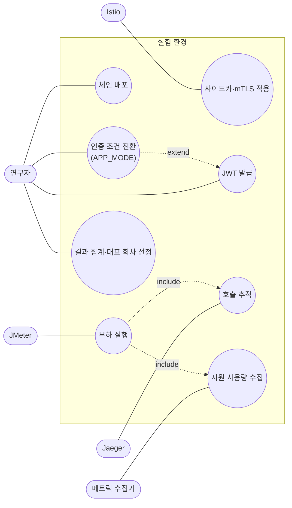

# 실험 요구사항

> 개발 단계: **② 요구사항** · 산출물: 액터, Use Case, 기능·비기능 요구사항(MoSCoW)
> 상태 표시: ✅ 저장소 코드로 충족 · ⚠️ 일부 충족 · 🧪 실험 환경에서 수동으로 충족(설정이 저장소에 없음)

## 1. 액터

| 액터 | 설명 |
|---|---|
| 연구자 | 환경을 배포하고, 조건을 바꾸고, 측정을 실행·분석하는 사람 |
| JMeter (Load Generator) | `/api/chain`에 부하를 보내고 TPS·응답 시간을 기록 |
| Jaeger | 서비스가 보낸 스팬을 모아 호출 구간별 시간을 보여 줌 |
| 메트릭 수집기 (Prometheus 등) | 컨테이너별 CPU·메모리를 수집 |
| Istio 컨트롤 플레인 | 사이드카 주입과 mTLS 정책을 적용 |

## 2. Use Case 다이어그램

## 3. 기능 요구사항

**MoSCoW:** M = 반드시, S = 해야 함, C = 있으면 좋음, W = 이번 범위 아님

| ID | 요구사항 | 우선 | 상태 | 근거 |
|---|---|---|---|---|
| FR-01 | Gateway → Order → Inventory → User 순서로 동기 호출하는 체인을 제공한다 | M | ✅ | `*ChainController`, Feign 클라이언트 |
| FR-02 | 진입점은 `GET /api/chain` 하나이고, 응답에 각 서비스 이름·깊이·모드를 담는다 | M | ✅ | [API_SPEC.md](./API_SPEC.md) |
| FR-03 | 코드 변경 없이 환경변수 하나(`APP_MODE`)로 인증 없음/JWT Relay를 전환한다 | M | ✅ | `application-{no-auth,jwt-relay}.yml` |
| FR-04 | JWT Relay 모드에서 모든 서비스가 HS256 서명을 검증한다 | M | ✅ | `JwtRelaySecurityConfig` |
| FR-05 | JWT Relay 모드에서 받은 `Authorization` 헤더를 다음 서비스 호출에 그대로 붙인다 | M | ✅ | `FeignAuthorizationRelayInterceptor` |
| FR-06 | 실험용 JWT를 같은 비밀키로 만들 수 있는 도구를 제공한다 | M | ✅ | `benchmark-tools` |
| FR-07 | 모든 서비스가 OTLP로 트레이스를 보내고, 로그에 traceId·spanId를 남긴다 | M | ✅ | `application.yml` |
| FR-08 | Prometheus 형식 메트릭을 노출한다 | S | ⚠️ | `/actuator/prometheus`. JWT 모드에서는 인증이 필요해 수집기가 그대로는 못 읽음 ([VERIFICATION.md](./VERIFICATION.md#3-알려진-문제)) |
| FR-09 | 서비스마다 인위적 지연(`ARTIFICIAL_LATENCY_MS`)을 넣어 병목을 흉내 낼 수 있다 | C | ✅ | 본 실험에서는 0 |
| FR-10 | Kubernetes 매니페스트로 4개 서비스를 한 워커 노드에 배포한다 | M | ✅ | `k8s/`, node affinity |
| FR-11 | Step 2(사이드카만)와 Step 3(mTLS STRICT)을 Istio 설정으로 전환한다 | M | 🧪 | Istio 설정 파일은 저장소에 없음 ([STATUS.md](./STATUS.md)) |
| FR-12 | 인증 없음/JWT용 JMeter 테스트 플랜을 제공한다 | M | ✅ | `jmeter/*.jmx` (기본값은 10스레드, 실험 때 조정) |
| FR-13 | 로컬에서 Docker Compose로 체인과 Jaeger를 한 번에 띄운다 | S | ✅ | `docker-compose.yml` |
| FR-14 | 측정 자동화 스크립트(배포 → 대기 → 웜업 → 측정 → 수집) | C | ⏳ | 수동 진행 |
| FR-15 | 사이드카 없는 메시, 다른 언어 서비스 비교 | W | — | [PROBLEM_DEFINITION.md §5](./PROBLEM_DEFINITION.md#제외) |

## 4. 비기능 요구사항 (실험 타당성)

| ID | 요구사항 | 우선 | 어떻게 지키나 |
|---|---|---|---|
| NFR-01 | **변인 통제:** 조건 사이에 애플리케이션 코드가 달라지지 않는다 | M | 단일 코드베이스 + 프로파일 전환. Step 0·2·3은 같은 `no-auth` 이미지 |
| NFR-02 | **자원 격리:** 부하 발생기·관측 도구가 측정 대상과 CPU를 나눠 쓰지 않는다 | M | 노드 3대 분리, 서비스는 node affinity로 워커 노드 고정 |
| NFR-03 | **콜드 스타트 배제:** JVM 초기화·JIT 영향이 측정에 섞이지 않는다 | M | Startup Wait 1~3분 → Warm-up 10~60초 → 본 측정 60초 |
| NFR-04 | **반복성:** 조건마다 3회 측정하고, 평균에 가장 가까운 회차를 대표로 쓴다 | M | 측정 절차 |
| NFR-05 | **재현성:** 다른 사람이 같은 환경을 다시 만들 수 있다 | S | 이미지·매니페스트·JMX·가이드 제공. Istio·모니터링 설정은 보완 필요 |
| NFR-06 | **관측 비용 통제:** 추적·수집 도구가 측정 대상을 불안정하게 만들지 않는다 | S | Jaeger 설정 조정 ([RUNBOOK.md](./RUNBOOK.md#rb-01-jaeger-메모리-증가로-노드가-멈춤)) |
| NFR-07 | **비밀값 관리:** 실제 비밀값을 저장소에 올리지 않는다 | S | `.env`는 `.gitignore`. 저장소 기본값은 실험용 공개 값 |
