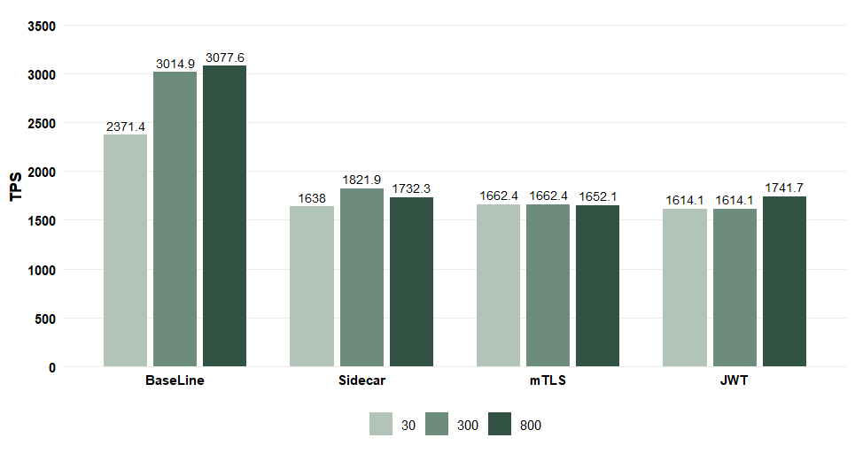
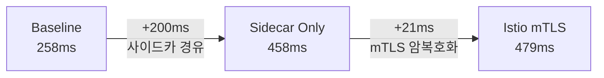
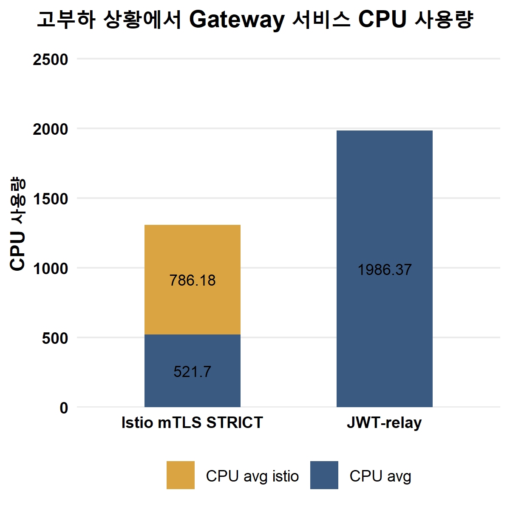
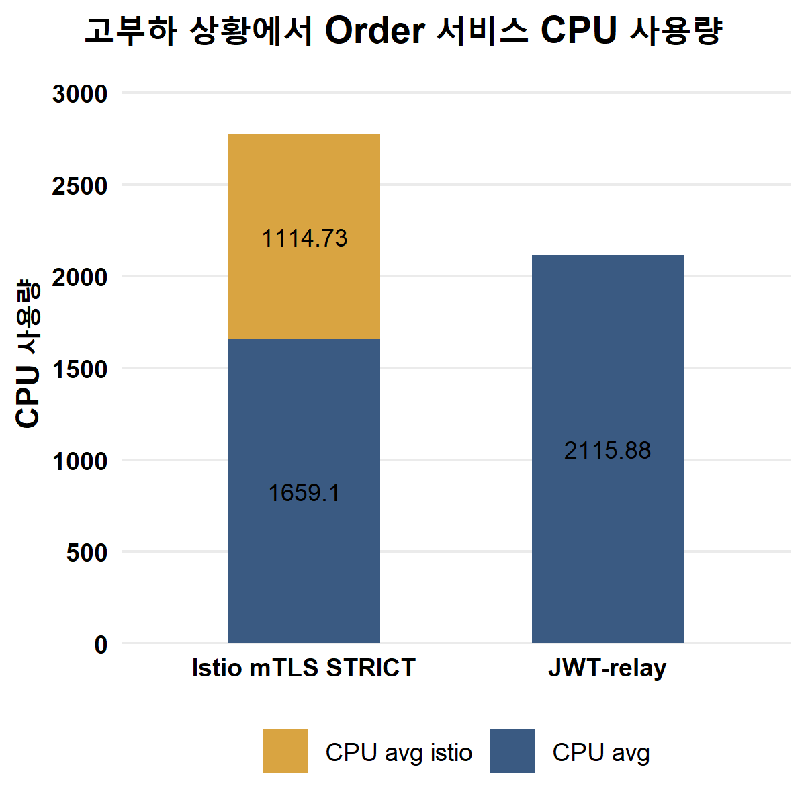
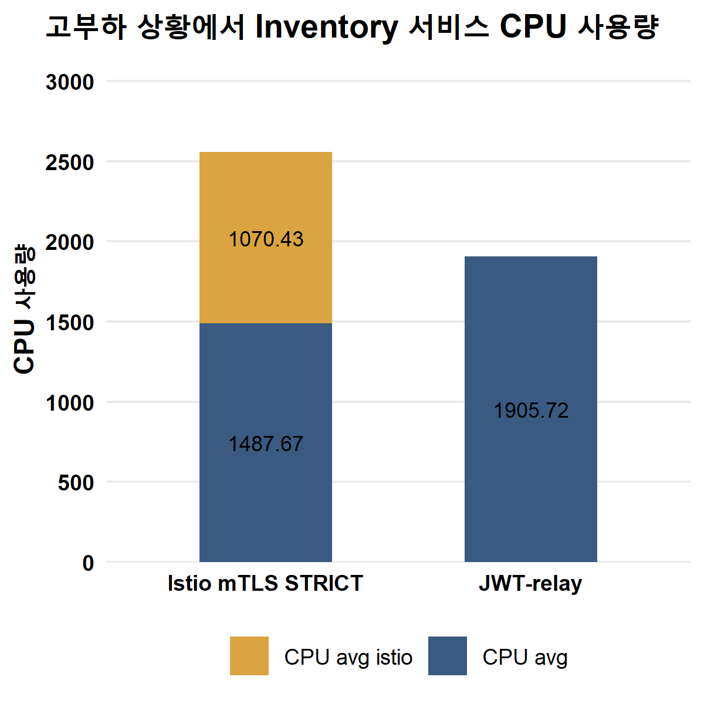
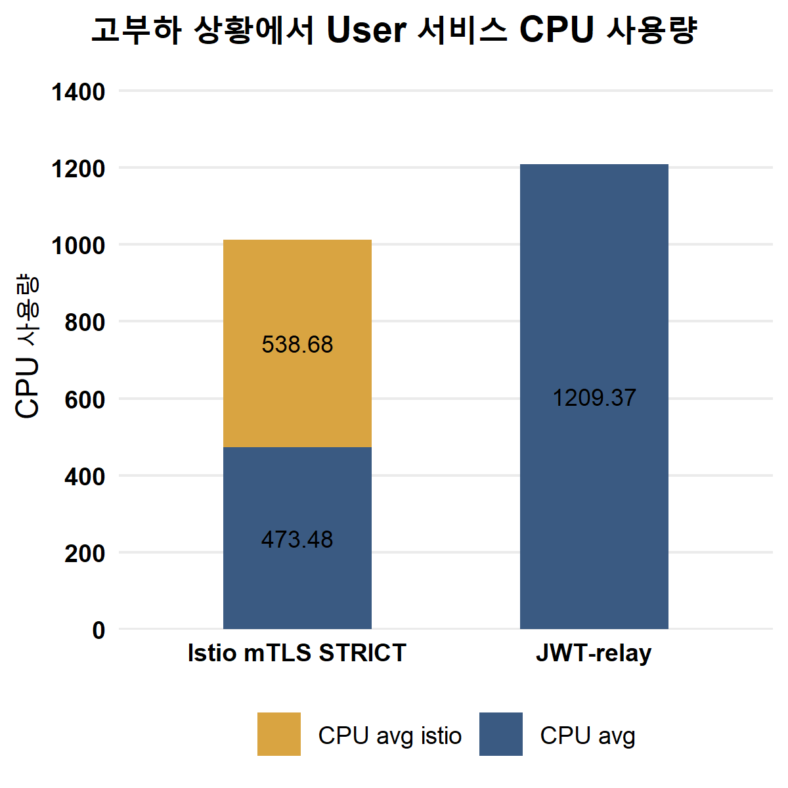

# 실험 결과

> 개발 단계: **⑥ 테스트(측정)** · 산출물: 측정 결과, 분석, 타당성 검토
> 근거: 논문 본문 4장과 그림 4-1~4-6. 수치는 조건별 3회 측정 중 대표 회차입니다. 원자료는 별도 측정 시트로 관리합니다.
> 조건(Step 0~3)과 부하(30/300/800)는 [EXPERIMENT_DESIGN.md](./EXPERIMENT_DESIGN.md)를 보세요.

## 요약

| 질문 | 결과 |
|---|---|
| RQ1. 처리량·지연 | 저부하(30)에서는 JWT와 mTLS 모두 18ms로 같았습니다. 고부하(800)에서는 JWT 447ms, mTLS 479ms로 mTLS가 32ms 느렸고, TPS는 JWT 1,741.7 / mTLS 1,652.1로 약 5% 차이였습니다 |
| RQ2. 비용 분리 | 고부하에서 Baseline 대비 mTLS 지연 증가 221ms 중 **사이드카 경유가 200ms**, **순수 mTLS가 21ms**였습니다. 서비스 메시 비용의 대부분은 프록시를 한 번 더 거치는 데서 나왔습니다 |
| RQ3. CPU 위치 | JWT는 모든 애플리케이션 컨테이너가 높은 CPU를 썼습니다. mTLS는 애플리케이션 CPU가 줄고 그만큼 `istio-proxy`로 옮겨 갔습니다. 앱 + 사이드카 합계는 Gateway·User에서는 JWT보다 적고 Order·Inventory에서는 더 많았습니다 |

## 1. 처리량과 지연 시간

### 1.1 TPS

| 조건 | 30 | 300 | 800 |
|---|---:|---:|---:|
| Step 0 Baseline | 2,371.4 | 3,014.9 | **3,077.6** |
| Step 2 Sidecar Only | 1,638.0 | 1,821.9 | 1,732.3 |
| Step 3 Istio mTLS | 1,662.4 | 1,662.4 | 1,652.1 |
| Step 1 JWT Relay | 1,614.1 | 1,614.1 | 1,741.7 |

- 인증·프록시가 들어간 세 조건은 모두 1,600~1,800 TPS에서 막혔고, Baseline은 3,000 TPS를 넘었습니다.
- 고부하에서 JWT(1,741.7)와 mTLS(1,652.1)의 TPS 차이는 약 5%입니다. 앱 안에서 매 호출 서명을 검증하는 비용이 프록시 비용과 비슷한 수준으로 처리량을 낮췄습니다.

### 1.2 평균 지연 시간 (ms)

| 조건 | 30 | 300 | 800 |
|---|---:|---:|---:|
| Step 0 Baseline | 12 | 99 | 258 |
| Step 2 Sidecar Only | 18 | 165 | 458 |
| Step 3 Istio mTLS | 18 | 168 | 479 |
| Step 1 JWT Relay | 18 | 169 | 447 |

- 저부하에서는 인증 방식 사이에 차이가 없었습니다(모두 18ms, Baseline보다 6ms).
- 부하가 오를수록 차이가 벌어졌고, 고부하에서 mTLS가 JWT보다 32ms 느렸습니다.
- 논문 본문은 같은 값을 반올림해 "JWT 430~440ms, mTLS 약 480ms, 차이 약 40ms"로 적었습니다. 이 문서는 그림 4-2의 값을 씁니다.

## 2. 순수 mTLS 오버헤드 (Step 2 vs Step 3)

| 부하 | Baseline | Sidecar Only | Istio mTLS | 프록시 비용 (2−0) | 순수 mTLS 비용 (3−2) |
|---|---:|---:|---:|---:|---:|
| 30 | 12 | 18 | 18 | 6 | **0** |
| 300 | 99 | 165 | 168 | 66 | **3** |
| 800 | 258 | 458 | 479 | 200 | **21** |

- 고부하에서도 순수 mTLS 비용은 21ms였습니다. TLS 연결이 커넥션 풀로 재사용되어 요청마다 핸드셰이크를 하지 않기 때문으로 해석했습니다.
- 서비스 메시 도입 비용을 줄이려면 암호화보다 **프록시 경유 비용**을 먼저 봐야 합니다.

## 3. 컨테이너별 CPU (고부하 800, millicore)

<table>
  <tr>
    <td></td>
    <td></td>
  </tr>
  <tr>
    <td></td>
    <td></td>
  </tr>
</table>

| 서비스 (깊이) | JWT 앱 | mTLS 앱 | mTLS `istio-proxy` | mTLS 합계 | 합계 비교 (mTLS − JWT) |
|---|---:|---:|---:|---:|---:|
| gateway (0) | 1,986.37 | 521.70 | 786.18 | 1,307.88 | −678.49 |
| order (1) | 2,115.88 | 1,659.10 | 1,114.73 | 2,773.83 | +657.95 |
| inventory (2) | 1,905.72 | 1,487.67 | 1,070.43 | 2,558.10 | +652.38 |
| user (3) | 1,209.37 | 473.48 | 538.68 | 1,012.16 | −197.21 |

- **JWT:** 모든 서비스가 매 요청 서명을 다시 검증해, 체인 전체에서 앱 CPU가 높게 유지됐습니다. 특히 진입점 Gateway가 1,986m를 썼습니다.
- **mTLS:** 앱 CPU는 모든 서비스에서 줄었습니다(Gateway −74%, User −61%). 보안 연산이 앱 밖의 `istio-proxy`로 옮겨 가, 애플리케이션 컨테이너가 쓸 CPU가 확보됩니다.
- **합계로 보면:** mTLS가 CPU를 덜 쓰는 것은 아닙니다. 체인 중간의 Order·Inventory는 합계가 JWT보다 650m가량 많았습니다. 두 서비스는 사이드카가 받는 요청(인바운드)과 보내는 요청(아웃바운드)을 모두 mTLS로 처리하기 때문으로 보입니다. mTLS로 얻는 것은 **자원 격리**입니다.

## 4. 결론

1. 고부하에서 mTLS는 JWT보다 32ms 느리고 처리량은 약 5% 낮았습니다. 순수 암호화 비용은 21ms로 작았습니다.
2. mTLS는 보안 연산을 사이드카로 옮겨 애플리케이션 CPU를 지켰습니다. 대신 프록시가 그만큼 CPU를 씁니다.
3. 정책을 인프라에서 한 번에 적용할 수 있고 언어가 다른 서비스에도 같은 보안을 줄 수 있다는 점까지 고려해, **대규모 MSA의 서비스 간 인증에는 Istio mTLS가 더 적합하다**고 결론지었습니다.

## 5. 타당성 검토

결과를 해석할 때 고려할 한계입니다.

| 항목 | 영향 | 보완 방향 |
|---|---|---|
| 서비스에 비즈니스 로직이 없음 | 인증·프록시 비용 비중이 실제보다 큼 | 처리 시간이 있는 엔드포인트(`ARTIFICIAL_LATENCY_MS` 등)로 추가 측정 |
| 서비스 4개가 워커 노드 하나의 CPU를 공유 | 서비스별 CPU가 서로 영향을 받음 | 서비스별 노드 분리 또는 CPU requests/limits 지정 |
| 조건별 3회 측정 | 차이가 통계적으로 유의한지 판단 어려움 | 반복 횟수를 늘리고 표준편차·신뢰구간 제시 |
| 트레이싱 샘플링이 측정에 포함 | 트레이스 생성·전송 비용이 모든 조건에 섞임 | 측정 시 샘플링 비율을 고정하고 기록 |
| JWT는 HS256만 측정 | RS256 등 비대칭 서명은 검증 비용이 다름 | 알고리즘별 추가 측정 |
| Step 2의 Istio 설정이 저장소에 없음 | 프록시 비용·mTLS 비용 분리가 설정에 달려 있음 | 당시 `PeerAuthentication`·`DestinationRule` 보관 ([DEPLOYMENT.md §4](./DEPLOYMENT.md#4-조건별-설정)) |
| p99는 본문에 수치가 없음 | 꼬리 지연 비교 불가 | p99를 결과 표에 추가 |
