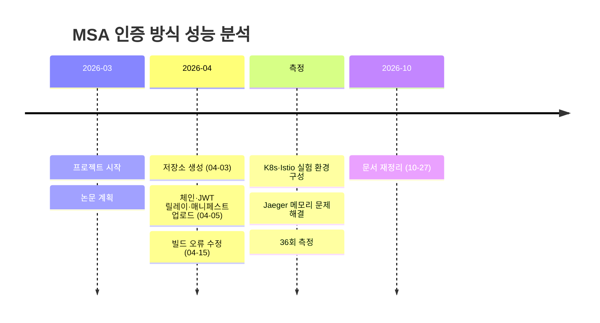

# 진행 현황

> 개발 단계: **⑤ 구현 / ⑦ 수정 및 문서화** · 산출물: 구현 현황, 일정, 남은 과제
> 진행 상태는 이 문서에서만 관리합니다.

## 1. 기준 시점

| 항목 | 값 |
|---|---|
| 기준일 | 2026-10-27 |
| 커밋 | `main` @ `b2272ca` |
| 논문 | 본문에 결과·결론까지 작성 |
| 마지막 코드 검증 | [VERIFICATION.md](./VERIFICATION.md) |

## 2. 구성 요소별 상태

✅ 완료 · ⚠️ 동작하지만 알려진 문제 있음 · 🧪 실험 때 수동 구성(저장소에 없음)

| 영역 | 항목 | 상태 | 비고 |
|---|---|---|---|
| 애플리케이션 | 3-Depth 체인 (서비스 4개) | ✅ | |
| 애플리케이션 | `no-auth` / `jwt-relay` 프로파일 전환 | ✅ | |
| 애플리케이션 | JWT 검증·릴레이 | ⚠️ | actuator도 인증 필요 ([KI-01](./VERIFICATION.md#ki-01-jwt-relay-모드에서-actuator가-401을-반환)) |
| 애플리케이션 | 트레이싱(OTLP), Prometheus 메트릭 | ✅ | |
| 도구 | JWT 생성 CLI | ✅ | |
| 도구 | JMeter 플랜 | ✅ | 기본값은 실험 조건과 다름 |
| 배포 | Dockerfile, Docker Compose | ✅ | |
| 배포 | Kubernetes 매니페스트 | ⚠️ | 노드 이름 교체 필요, Step 1 프로브 문제 |
| 배포 | Istio 설치·정책 (Step 2·3) | 🧪 | |
| 배포 | Jaeger·Prometheus 설치 | 🧪 | |
| 측정 | 36회 측정 (조건 4 × 부하 3 × 3회) | ✅ | 결과는 [RESULTS.md](./RESULTS.md) |
| 측정 | 측정 자동화 스크립트 | ⏳ | 수동 진행 |

## 3. 일정

| 커밋 | 날짜 | 작성자 | 내용 |
|---|---|---|---|
| `08a459a` | 2026-04-03 | 김형균 | 저장소 생성 |
| `776f27a` | 2026-04-05 | 김형균 | 초기 프로젝트 업로드 (모듈 7개, 매니페스트, JMeter, 가이드) |
| `c16936d` | 2026-04-15 | 최가은 | 메이븐 빌드 오류 수정 (`benchmark-tools`) |
| `b2272ca` | 2026-10-27 | 김형균 | README 포트폴리오 형식 정리, ignore 보강 |

측정 기간은 커밋 이력에 남아 있지 않아 월을 적지 않았습니다.

## 4. 남은 과제

우선순위: **P1** 재현에 꼭 필요 · **P2** 결과 신뢰도 향상 · **P3** 확장

| 우선순위 | 항목 | 관련 |
|---|---|---|
| P1 | 실험 당시 Istio 설정(`PeerAuthentication`·`DestinationRule`, NodePort 진입 처리)을 `k8s/istio/`에 보관 | [DEPLOYMENT.md §4](./DEPLOYMENT.md#4-조건별-설정), ADR-005 |
| P1 | `jwt-relay`에서 actuator 인증 제외 또는 프로브 변경 | [KI-01](./VERIFICATION.md#ki-01-jwt-relay-모드에서-actuator가-401을-반환) |
| P1 | 측정 조건(스레드·Ramp-up·측정 시간)을 반영한 JMeter 플랜 추가 | [KI-04](./VERIFICATION.md#ki-04-jmeter-플랜-기본값이-실험-조건과-다름) |
| P2 | p99 지연 시간과 회차별 표준편차를 결과에 추가 | [RESULTS.md §5](./RESULTS.md#5-타당성-검토) |
| P2 | 측정 시 트레이싱 샘플링 비율을 고정하고 조건별로 기록 | RB-01 |
| P2 | Jaeger 스팬으로 구간별(서비스·프록시) 지연을 분리한 결과 정리 | [EXPERIMENT_DESIGN.md §4](./EXPERIMENT_DESIGN.md#4-평가-지표) |
| P2 | 배포 → 대기 → 웜업 → 측정 → 수집 자동화 스크립트 | FR-14 |
| P3 | 비즈니스 처리 시간이 있는 시나리오, RS256 등 다른 서명 알고리즘 | [RESULTS.md §5](./RESULTS.md#5-타당성-검토) |
| P3 | 사이드카 없는 메시(Istio Ambient)와 비교 | [PROBLEM_DEFINITION.md §5](./PROBLEM_DEFINITION.md#제외) |
